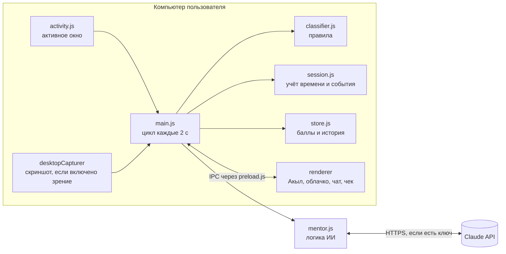

# Nazar · QUANTIX · National Founder Cup 2026 (Шымкент)

**Название:** Nazar — пиксельный ИИ-ментор на экране ноутбука
**Трек:** The Attention Economy (проблемная зона 4, Digital Economy & Future Tech)
**Команда:** QUANTIX

> **Сначала цель, потом лента.** Человек называет цель, а маленький ментор Акыл живёт внизу экрана, замечает уход в рилсы, договаривается о перерыве и в конце выдаёт честный чек внимания.

## О проекте

**Один пользователь, одна боль.** Студентка Айгерим садится писать курсовую, «на минутку» открывает Instagram и теряет 40 минут в рилсах. Платформы зарабатывают на её внимании, а она не видит, сколько его отдала, и ничего не получает взамен.

**Что уже работает.** Десктоп-приложение: Акыл поверх всех окон, отслеживание активного окна, напоминания, чат с действиями, чек внимания, баллы и уровни. Без API-ключа всё работает на правилах и шаблонах.

**Ответ на вопросы трека**

| Вопрос | Ответ Nazar | Статус |
|---|---|---|
| Как лучше контролировать внимание? | Цель на сессию, мягкие напоминания, чек внимания | Работает в MVP |
| Как сделать взаимодействие прозрачным? | Пользователь видит, сколько минут и куда ушло: процент фокуса, поминутная лента, главные «воры» внимания | Работает в MVP |
| Может ли пользователь получать выгоду? | Баллы за удержанный фокус, которые партнёры обменивают на скидки | Баллы работают, обмен запланирован |

### USP

| Обычный блокировщик | Nazar |
|---|---|
| Не знает цель | Каждая сессия начинается с цели, всё оценивается относительно неё |
| Запрещает сайты по списку | ИИ понимает контекст: лекция по физике на YouTube — это фокус, шортсы — отвлечение |
| Молча блокирует, и его отключают | Живой персонаж напоминает, с ним можно договориться: «дай 5 минут перерыва» |
| Нет обратной связи | Чек внимания: сколько по делу, сколько утекло и куда |

## Демо

**Видео:** ⚠️ ДОБАВИТЬ ССЫЛКУ (YouTube или Google Диск с открытым доступом)

## Что умеет MVP

- **Акыл на экране.** Прозрачное окно поверх всех программ, клики проходят насквозь. Персонаж гуляет, бегает, прыгает, спит, его можно перетащить мышкой.
- **Видит активность.** Приложение и заголовок активного окна; опционально «зрение»: раз в ~45 секунд скриншот анализирует Claude. Зрение выключено по умолчанию и требует API-ключ.
- **Реагирует.** Через 20 секунд отвлечения бежит к центру экрана с «!», через 2 минуты предлагает честный перерыв, хвалит за возврат к цели.
- **Чат с действиями.** «Дай перерыв 5 минут», «продли на 15», «как я?», «я закончил». Приложение выполняет действие, на перерыв Акыл засыпает.
- **Чек внимания.** Процент фокуса, поминутная лента, главные отвлечения, число напоминаний и возвратов, совет на следующий раз, баллы и уровень.
- **Офлайн-режим.** Без ключа работают правила и шаблоны реплик.
- **Озвучка.** По желанию, через системный синтезатор речи.

## Стек

| Часть | Технология |
|---|---|
| Десктоп-приложение | Electron 44 (встроенные Node.js 24 и Chromium 152) |
| Интерфейс | HTML, CSS и JavaScript без фреймворков, пиксель-арт на Canvas из текстовых матриц |
| ИИ | Claude API (`@anthropic-ai/sdk`), по умолчанию модель `claude-opus-5-5`: structured outputs и vision |
| Трекинг окна | PowerShell + WinAPI (Windows), AppleScript (macOS), xdotool (Linux), без нативных модулей |
| Хранение | Локальный JSON `nazar-data.json` в папке данных приложения, базы данных нет |
| Тесты | Встроенный `node:test` |
| Шрифты | Tiny5, Press Start 2P (лицензия OFL, лежат в проекте) |

## Архитектура



**Цикл работы (каждые 2 секунды)**

1. `activity.js` отдаёт активное окно: приложение и заголовок (на macOS ещё и URL вкладки).
2. `classifier.js` по правилам ставит категорию `focus`, `distraction` или `neutral`. Слово из цели в заголовке даёт фокус.
3. Если правила не уверены (YouTube, мессенджер, неизвестное приложение), окно отправляется в Claude. Ответ кэшируется по заголовку.
4. Если включено зрение, свежий анализ скриншота уточняет вердикт.
5. `session.js` копит время и создаёт события: `drift`, `drift-long`, `back`, `break-over`, `time-up`.
6. Интерфейс получает событие, и Акыл реагирует.

### Логика ИИ-компонентов (`src/main/mentor.js`)

| Функция | Когда вызывается | Что получает Claude | Что возвращает |
|---|---|---|---|
| `classifyWindow` | Правила не уверены | Цель, приложение, заголовок, URL | JSON `{category, reason}` |
| `analyzeScreen` | Раз в ~45 с, если включено зрение | Цель, активное окно, скриншот JPEG | JSON `{on_task, activity, confidence, comment}` |
| `chat` | Сообщение в чате | Цель, статистика сессии, текущее окно, история | JSON `{reply, action, minutes}`, приложение выполняет действие |
| `reportInsight` | Конец сессии | Итоги сессии | Текст: 2–3 предложения с советом |

JSON-ответы приходят через structured outputs по схеме, поэтому действия выполняются предсказуемо. При ошибке сети или отказе модели приложение переходит на офлайн-правила и шаблоны, демо не ломается.

## Как запустить

Нужны Node.js 22+ и npm. Запуск проверен на Windows 11.

```bash
git clone https://github.com/hackathon-kz/national-founder-cup-shymkent-2026-69-quantix.git
cd national-founder-cup-shymkent-2026-69-quantix
npm install
cp .env.example .env    # в Windows cmd: copy .env.example .env
npm start
```

При первом `npm start` автоматически скачивается Electron (около 370 МБ в распакованном виде), нужен интернет.

- **Windows:** дополнительная настройка не нужна.
- **macOS:** разрешите *Универсальный доступ*, *Запись экрана* (для зрения) и автоматизацию браузера в настройках конфиденциальности.
- **Linux:** нужны `xdotool` (`sudo apt install xdotool`) и X11.

**Тесты логики:** `npm test` (классификатор, сессия, спрайты).

### Как проверить за минуту

1. Нажмите на Акыла, впишите цель и нажмите «Погнали».
2. Откройте `instagram.com/reels` в браузере или нажмите `Ctrl+Shift+9` (демо-отвлечение на 40 секунд).
3. Примерно через 20 секунд Акыл побежит к центру экрана с напоминанием.
4. Нажмите на Акыла и попросите перерыв или напишите «я закончил», чтобы увидеть чек внимания.

**Управление:** клик по Акылу открывает чат или старт сессии, перетаскивание переставляет его, `Ctrl/Cmd+Shift+Space` открывает чат, `Ctrl+Shift+0` включает демо работы в VS Code. Новая сессия, завершение, зрение и выход находятся в меню иконки в трее.

## Переменные окружения

Все переменные перечислены в `.env.example`, настоящий `.env` в репозиторий не попадает. Обязательных переменных нет.

| Переменная | Значение по умолчанию | Назначение |
|---|---|---|
| `ANTHROPIC_API_KEY` | пусто | Ключ Claude API, без него работает офлайн-режим |
| `NAZAR_MODEL` | `claude-opus-5-5` | Модель Claude |
| `NAZAR_VISION` | выключено | `on` включает зрение при запуске |
| `NAZAR_VISION_INTERVAL_SEC` | `45` | Интервал анализа скриншотов |
| `NAZAR_DRIFT_SEC` | `20` | Через сколько секунд отвлечения срабатывает напоминание |

## Модель и экономика

Модель ниже является планом команды. На пользователях она ещё не проверялась.

- **Freemium для пользователя.** Базовый ментор бесплатно. Pro по подписке: зрение, расширенная аналитика, свои персонажи.
- **B2B2C для школ и колледжей.** Учебное заведение подключает учеников и видит только **обезличенную** статистику цифрового здоровья класса.
- **Партнёры вместо навязчивой рекламы.** Местный бизнес спонсирует награды за удержанный фокус: баллы Nazar обмениваются на скидки. Бизнес платит не за показы, а за связь бренда с полезной привычкой, а пользователь получает выгоду за собственный фокус.

**Основные затраты.** Вызовы Claude API. Без зрения это единичные запросы за сессию; со зрением один скриншот каждые 45 секунд, то есть около 33 за 25-минутную сессию. Поэтому зрение входит в Pro, а модель можно заменить более дешёвой через `NAZAR_MODEL`.

**Измеряемый эффект.** Процент фокуса за сессию, минуты, сэкономленные от ленты, число возвратов к цели и их динамика по неделям. Приложение считает эти показатели для каждой сессии.

## Приватность

- История и статистика хранятся только на устройстве.
- Без API-ключа ничего не уходит в сеть.
- С ключом в Claude API отправляются цель, заголовки окон и сообщения чата.
- Скриншоты отправляются, только если пользователь сам включил зрение, и нигде не сохраняются.

## Ограничения MVP

- В Windows и Linux приложение видит заголовок окна, но не URL вкладки, поэтому браузер определяется по заголовку.
- Без ключа неоднозначные окна вроде YouTube считаются нейтральными.
- Работает только на компьютере, телефон пока не отслеживается.

## Дорожная карта

- Android-версия (AccessibilityService).
- Расширение браузера с точными URL в Windows.
- Кабинет партнёров и обмен баллов на скидки.
- Казахская локализация интерфейса.

## Структура проекта

```
src/
  main/       main.js (окно, трей, цикл), activity.js, classifier.js, session.js, store.js, mentor.js, icon.js
  preload.js  безопасный мост IPC
  renderer/   index.html, style.css, buddy.js (анимация), app.js (интерфейс), fonts/
  shared/     sprites.js (пиксель-арт Акыла)
test/         тесты классификатора, сессии и спрайтов
```

## Команда

**QUANTIX**

⚠️ ДОБАВИТЬ: имя и роль каждого участника
