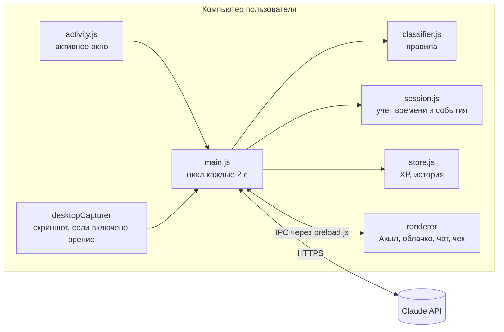

# Nazar — пиксельный ИИ-ментор на экране ноутбука

**Трек:** The Attention Economy · **Команда:** Quantix · National Founder Cup, Шымкент 2026

> **Сначала цель, потом лента.** Акыл — маленький пиксельный ментор, который живёт внизу экрана.
> Ты говоришь ему, над чем работаешь. Он видит, что происходит на экране, замечает, когда ты уходишь в рилсы,
> с ним можно поговорить и договориться о перерыве, а в конце сессии он выдаёт честный **чек внимания**.

## Проблема (один пользователь — одна боль)

Студентка Айгерим садится писать курсовую, «на минутку» открывает Instagram и теряет 40 минут в рилсах.
Платформы зарабатывают на её внимании, а она не видит, сколько его отдала, не контролирует это и ничего не получает взамен.
Блокировщики просто запрещают, и их отключают через день.

## Решение и USP

| Обычный блокировщик | Nazar |
|---|---|
| Не знает твою цель | Сессия начинается с цели — всё оценивается относительно неё |
| Запрещает сайты по списку | ИИ понимает контекст: лекция по физике на YouTube — фокус, шортсы — отвлечение |
| Молча блокирует | Живой персонаж мягко напоминает, с ним можно договориться («дай 5 минут перерыва») |
| Нет обратной связи | Чек внимания: сколько по делу, сколько утекло, кто главный «вор» внимания |
| Скучно | Пиксельный ментор, уровни, баллы, серия дней |

## Что умеет MVP

- **Акыл на экране**: прозрачное окно поверх всех программ, клики проходят насквозь. Персонаж гуляет, бегает, прыгает, спит, его можно перетащить мышкой.
- **Видит, что ты делаешь**:
  - активное окно и заголовок (Windows, macOS, Linux), на macOS ещё и URL вкладки Chrome/Safari;
  - **зрение** (по желанию): раз в ~45 секунд скриншот уходит в Claude, и тот решает, работаешь ли ты над целью. Скриншоты не сохраняются.
- **Реагирует**: через 20 секунд отвлечения бежит к центру экрана с «!», через 2 минуты предлагает честный перерыв, хвалит, когда ты вернулся.
- **Чат с действиями**: «дай перерыв 5 минут», «я закончил», «продли на 15», «как я?». ИИ сам выбирает действие (structured outputs), Акыл засыпает на перерыв.
- **Чек внимания**: процент фокуса, поминутная лента сессии, главные отвлечения, число возвратов к цели, вывод и совет от ИИ, баллы и уровень.
- **Офлайн-режим**: без ключа всё работает на правилах и шаблонах, демо не ломается.
- **Озвучка** (по желанию): голос через системный синтезатор речи.

## Стек

| Часть | Технология |
|---|---|
| Десктоп-приложение | Electron 44 (Node.js 22) |
| Интерфейс | HTML/CSS/JS без фреймворков, пиксель-арт рисуется на Canvas из текстовых матриц |
| ИИ | Claude API (`@anthropic-ai/sdk`), модель `claude-opus-5-5`, structured outputs, vision |
| Трекинг окна | PowerShell + WinAPI (Windows), AppleScript (macOS), xdotool (Linux), без нативных модулей |
| Хранение | Локальный JSON в папке пользователя (`userData/nazar-data.json`) |
| Шрифты | Tiny5, Press Start 2P (OFL, лежат в проекте) |

## Архитектура



**Цикл работы (каждые 2 секунды):**
1. `activity.js` отдаёт активное окно: приложение, заголовок, URL.
2. `classifier.js` по правилам ставит категорию: `focus` / `distraction` / `neutral`. Слова из цели в заголовке дают фокус.
3. Если правила не уверены (YouTube, мессенджеры, неизвестный сайт), окно один раз отправляется в Claude (`classifyWindow`). Ответ кэшируется.
4. Если включено зрение, свежий анализ скриншота (`analyzeScreen`) уточняет вердикт.
5. `session.js` копит время и генерирует события: `drift` → `drift-long` → `back`, `break-over`, `time-up`.
6. Renderer получает событие, и Акыл реагирует: бежит, говорит, прыгает, засыпает.

### Логика ИИ-компонентов (`src/main/mentor.js`)

| Функция | Когда вызывается | Что получает Claude | Что возвращает |
|---|---|---|---|
| `classifyWindow` | неуверенное окно, один раз на заголовок | цель + приложение + заголовок + URL | JSON `{category, reason}` |
| `analyzeScreen` | раз в ~45 с, если включено зрение | цель + скриншот (JPEG) | JSON `{on_task, activity, confidence, comment}` |
| `chat` | сообщение в чате | цель, статистика сессии, текущее окно, история | JSON `{reply, action, minutes}` → приложение выполняет действие |
| `reportInsight` | конец сессии | итоги сессии | 2–3 предложения с советом |

Все ответы приходят через **structured outputs** (JSON-схема), поэтому приложение надёжно выполняет действия.
Включён серверный фолбэк при отказе модели. При любой ошибке сети используются офлайн-шаблоны.

## Запуск локально

Нужен Node.js 20+.

```bash
git clone <repo-url>
cd <repo>
npm install
cp .env.example .env      # впишите ANTHROPIC_API_KEY (можно оставить пустым — офлайн-режим)
npm start
```

- **Windows:** работает сразу.
- **macOS:** при первом запуске разрешите *Универсальный доступ* (заголовки окон), *Запись экрана* (зрение) и автоматизацию браузера в «Системных настройках → Конфиденциальность».
- **Linux:** нужен `xdotool` (`sudo apt install xdotool`) и X11.

Тесты логики: `npm test`

### Управление
- **Клик по Акылу**: чат (или старт сессии). **Перетаскивание**: переставить.
- **Ctrl/Cmd+Shift+Space**: открыть чат.
- **Иконка в трее**: новая сессия, завершить и показать чек, зрение вкл/выкл, демо-режим, выход.
- **Демо для защиты:** `Ctrl+Shift+9` изображает отвлечение на Reels, `Ctrl+Shift+0` — работу в VS Code (на 40 секунд).

## Приватность
- История и статистика хранятся только на устройстве.
- Зрение выключено по умолчанию и включается явно. Скриншоты отправляются в Claude API для анализа и нигде не сохраняются.
- Без ключа API ничего не уходит в сеть.

## Модель и экономика

- **Freemium для пользователя**: базовый ментор бесплатно, Pro (зрение, расширенная аналитика, свои персонажи) — подписка.
- **B2B2C для школ и колледжей**: учебное заведение подключает учеников и видит **обезличенную** статистику цифрового здоровья класса.
- **Партнёры**: местный бизнес спонсирует награды за удержанный фокус (баллы Nazar → скидки). Бизнес платит не за показы, а за ассоциацию бренда с полезной привычкой.

**Измеряемый эффект:** % фокуса за сессию, минуты, сэкономленные от ленты, число возвратов к цели и их динамика по неделям.

## Структура

```
src/
  main/        main.js (окно, трей, цикл), activity.js, classifier.js, session.js, store.js, mentor.js, icon.js
  preload.js   безопасный мост IPC
  renderer/    index.html, style.css, buddy.js (анимация), app.js (интерфейс), fonts/
  shared/      sprites.js (пиксель-арт Акыла)
test/          тесты классификатора, сессии и спрайтов
```

## Дорожная карта
- Android-версия (AccessibilityService) для телефона.
- Расширение браузера с точными URL на Windows.
- Кабинет партнёров и обмен баллов.
- Казахская локализация интерфейса.
