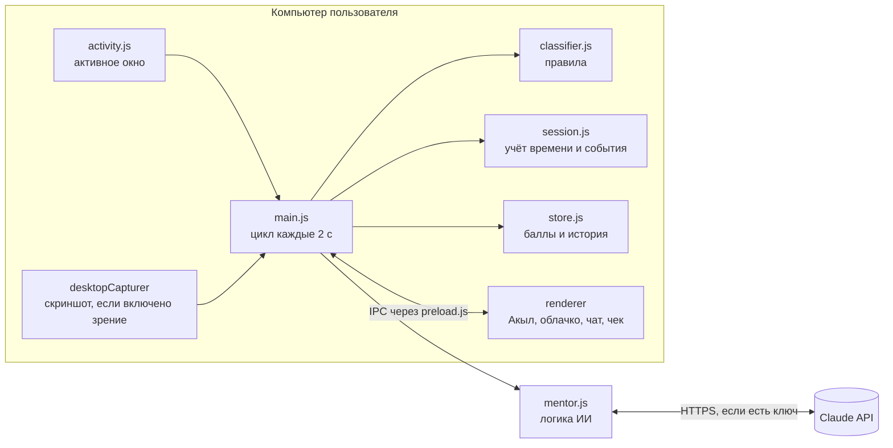

# Nazar · QUANTIX · National Founder Cup 2026 (Шымкент)

**Название:** Nazar — пиксельный ИИ-ментор на экране ноутбука
**Трек:** The Attention Economy (проблемная зона 4, Digital Economy & Future Tech)
**Команда:** QUANTIX

> **Сначала цель, потом лента.** Человек называет цель, а маленький ментор Акыл живёт внизу экрана, замечает уход в рилсы, договаривается о перерыве и в конце выдаёт честный чек внимания.

## О проекте

**Один пользователь, одна боль.** Студентка Айгерим садится писать курсовую, «на минутку» открывает Instagram и теряет 40 минут в рилсах. Платформы зарабатывают на её внимании, а она не видит, сколько его отдала, и ничего не получает взамен.

**Что уже работает.** Десктоп-приложение: Акыл поверх всех окон, отслеживание активного окна, напоминания, чат с действиями, чек внимания, баллы и уровни. Без API-ключа всё работает на правилах и шаблонах.

### USP

| Обычный блокировщик | Nazar |
|---|---|
| Не знает цель | Каждая сессия начинается с цели, всё оценивается относительно неё |
| Запрещает сайты по списку | ИИ понимает контекст: лекция по физике на YouTube — это фокус, шортсы — отвлечение |
| Молча блокирует, и его отключают | Живой персонаж напоминает, с ним можно договориться: «дай 5 минут перерыва» |
| Нет обратной связи | Чек внимания: сколько по делу, сколько утекло и куда |

## Демо

**Видео:** ⚠️ ДОБАВИТЬ ССЫЛКУ (YouTube или Google Диск с открытым доступом)

## Исследование: что мы выяснили

| Факт | Что это значит для Nazar |
|---|---|
| В Казахстане **18,3 млн** учётных записей в соцсетях, это **86,6%** населения (октябрь 2026). Учётные записи не равны уникальным людям [1] | Проблема массовая, рынок уже здесь |
| Использование коротких видео связано с более слабым вниманием, **r = −0,38**, и самоконтролем, **r = −0,41** (71 исследование). Большинство работ корреляционные, причинность не доказана. Интенсивность связана сильнее, чем время просмотра [2] | Считать только минуты мало, важен контекст и цель |
| В рандомизированном эксперименте возможность самому поставить лимит заметно снижала использование. По оценке модели авторов, проблемы самоконтроля дают **31%** времени в соцсетях (взрослые, США) [3] | Человеку нужен инструмент, который он выбирает сам |
| **29,5%** интернет-пользователей применяют блокировщики рекламы. Главные причины: слишком много рекламы (63,5%) и она мешает (53,5%) [4] | Показы раздражают, нужна другая модель |
| Президент Казахстана поддержал запрет регистрации в соцсетях для детей до 16 лет. Закон на момент поиска окончательно не принят [5] | Запрет не поможет студентам старше 16 лет, им нужен самоконтроль |

## Ответы на вопросы трека

### 1. Как пользователи могут лучше контролировать своё внимание?

**Не запрещать, а помогать держать собственную цель.** Контроль строится из трёх шагов, и все они работают в MVP:

1. **До:** человек сам называет цель и время сессии.
2. **Во время:** Акыл замечает отвлечение через 20 секунд и напоминает об этой цели, а о перерыве можно честно договориться в чате.
3. **После:** чек внимания показывает процент фокуса, поминутную ленту и главных «воров» внимания.

Опора на данные: добровольные ограничения снижают использование [3], а понимание контекста отличает лекцию на YouTube от шортсов.

### 2. Как сделать онлайн-рекламу более полезной и прозрачной?

**Убрать рекламу из момента концентрации и объяснять каждое предложение.** Правила для партнёрского блока (запланирован, в MVP его нет):

- Предложение появляется только в чеке после завершённой сессии, никогда во время работы.
- Блок подписан: кто спонсор и почему показано это предложение.
- Подбор идёт на устройстве, история внимания партнёрам не передаётся. Похожий подход уже применяет Brave Ads [6].
- Участие добровольное, блок можно отключить.

### 3. Можно ли создать модель, в которой пользователь получает выгоду от взаимодействия с рекламой?

**Да, и платить стоит за результат, а не за просмотр.** Прецедент: Brave заявляет, что отдаёт пользователям 70% дохода от добровольных рекламных показов [6]. Nazar идёт дальше и вознаграждает не за внимание к рекламе, а за внимание к своей цели:

```
Фокус-сессия → баллы Nazar → скидка у партнёра → покупка
Пользователь получает скидку · Партнёр платит за погашение · Nazar получает комиссию
```

Модель не поощряет проводить больше времени в приложении, потому что баллы начисляются за минуты фокуса и возвраты к цели. Эксперимент [3] показал, что временные стимулы сокращать соцсети дают устойчивый эффект. Сейчас в MVP работают баллы и уровни, обмен на скидки запланирован.

**Как проверим.** Пилот со студентами: неделя наблюдения, затем неделя с напоминаниями и сравнение процента фокуса и числа возвратов к цели. Результатов пилота пока нет.

### Источники

1. [DataReportal, Digital 2027: Kazakhstan](https://datareportal.com/reports/digital-2027-kazakhstan)
2. [Nguyen et al., Feeds, feelings, and focus, Psychological Bulletin, 2025](https://doi.org/10.1037/bul0000498)
3. [Allcott, Gentzkow, Song, Digital Addiction, American Economic Review, 2022](https://www.aeaweb.org/doi/10.1257/aer.20210867)
4. [Backlinko по данным GWI, Ad Blocker Users](https://backlinko.com/ad-blockers-users)
5. [Zakon.kz, Токаев поддержал инициативу](https://www.zakon.kz/politika/6529689-detyam-do-16-let-mogut-zapretit-registratsiyu-v-sotssetyakh-tokaev-podderzhal-initsiativu.html)
6. [Brave, запуск Brave Ads](https://brave.com/brave-ads-launch/)

## Что умеет MVP

- **Акыл на экране.** Прозрачное окно поверх всех программ, клики проходят насквозь. Размер на выбор (маленький, средний, большой), его можно перетащить мышкой.
- **Напористый тон.** Акыл подгоняет как тренер: «Погнали! Цель: курсовая. Давай-давай, работаем!», «Красава! 💪 Работай-работай!», «Темп, темп!». С ключом Claude отвечает в том же тоне.
- **Живой, но не мешает.** Без сессии гуляет, читает книжку, потягивается, оглядывается. Во время работы стоит на месте и тихо «работает рядом» на ноутбуке. Глазами следит за курсором, машет, если навести на него мышь. Каждые 10 минут фокуса радуется: подпрыгивает, и над головой всплывает «🔥 10 мин», без облачка и текста. После пробежки к центру из-за отвлечения сам возвращается на своё место. Ночью чаще зевает, на перерыве спит.
- **Видит активность.** Приложение и заголовок активного окна; опционально «зрение»: раз в ~45 секунд скриншот анализирует Claude. Зрение выключено по умолчанию и требует API-ключ.
- **Реагирует.** Через 20 секунд отвлечения бежит к центру экрана и злится: красный «!» над головой, брови домиком, трясёт кулаками, топает и каждые ~12 секунд ругается новой фразой с запиканным матом («Э, т#@%&\*$с, э! Хорош отвлекаться, давай-давай, работай-работай!»). После 6 фраз замолкает, но «!» висит, пока не вернёшься к делу. Через 2 минуты предлагает честный перерыв, за возврат хвалит и сам уходит на место.
- **Память.** Акыл помнит прошлые сессии: средний фокус, главных «воров» недели и лучшее время дня. На старте подсказывает, что закрыть заранее («за неделю Instagram съел 25 минут»), в чате сравнивает с твоим средним, в чеке говорит, стало лучше или хуже.
- **Учится на поправках.** Ошибся? Нажми «✅ Это по работе» в облачке или напиши «это лекция, не ругайся». Акыл запомнит эту страницу (именно её, а не весь YouTube) и больше не будет дёргать. «Запомни, это отвлечение» работает наоборот. Всё видно и редактируется в окне настроек.
- **Напоминания по ситуации.** Первое напоминание короткое, на третий раз за сессию Акыл предлагает закрыть вкладку совсем, а про привычного «вора» говорит отдельно. Если отвлечение затянулось, с ключом Claude он пишет личную реплику: что именно ты смотришь и как вернуться.
- **Блокировка выключения 🔒.** Включается галочкой при старте сессии (или по умолчанию в настройках). Пока идёт таймер, Акыла нельзя выключить кнопкой, через трей, «Выходом» или Alt+F4, а сессию нельзя завершить раньше времени, даже написав «я закончил». На каждую попытку Акыл выбегает в центр и ругается по-мультяшному, всё злее: рот закрывает чёрная цензурная полоска, сбоку мелькает «#@$%!», а в облачке — «ХАЛТУРЩИК! 🤬 #@$%&*! Это уже 3-я попытка!». Настоящих ругательств нет, только запиканный мат, а озвучка вместо символов говорит «пи-ип». Если убить Nazar через диспетчер задач, при следующем запуске сессия продолжится с того же места, и Акыл выскажет всё, что думает. Выход есть всегда, но осознанный: вписать «я сдаюсь» в окне Nazar или в чате. Тогда сессия закончится, в чеке будет «сдался досрочно» и число попыток, а опыта начислится вдвое меньше. Выключение и перезагрузка компьютера попыткой не считаются.
- **Перерывы по науке, а не «сколько попросишь».** Отдых зарабатывается фокусом с прошлого перерыва: примерно 1 минута на 5 минут работы по делу, до 10 минут, а после 90 минут непрерывного фокуса до 20. Время в ленте отдых не зарабатывает. Попросишь 15 минут после 20 минут работы — Акыл даст 4 и объяснит почему. После 50 и 90 минут фокуса он сам предлагает передышку. Основа: систематические перерывы примерно 1:4–1:5 дают меньше усталости и лучше концентрацию, чем перерывы «когда захочется» ([Biwer et al., 2023](https://pubmed.ncbi.nlm.nih.gov/36859717/)); перерывы до 10 минут снижают усталость, а после тяжёлой работы нужно больше ([Albulescu et al., 2022](https://doaj.org/article/c6f37b6ba159469296b2cb968b65505f)).
- **Чат с действиями.** «Дай перерыв», «продли на 15», «как я?», «я закончил». Приложение выполняет действие, на перерыв Акыл засыпает.
- **Счёт за внимание.** В чеке видно, сколько рекламных денег принесло платформам время в ленте: «Платформы заработали на тебе ≈ 9,8 ₸. Ты получил от них 0 ₸. Ты заработал у Nazar +25 баллов», и прогноз: «за неделю ≈ 124 ₸, за год ≈ 6 400 ₸». Расчёт: рекламный доход платформы за 2025 год ÷ часы её пользователей (YouTube ≈ $0,044 за час, короткие видео ≈ $0,06, Instagram ≈ $0,13). Это средние мировые оценки, в Казахстане реальная сумма ниже, поэтому везде стоит «≈». Сериалы и игры не считаются: они зарабатывают подпиской. Акыл использует сумму в напоминаниях и отвечает на «сколько на мне заработали?».
- **Чек внимания.** Процент фокуса, поминутная лента, главные отвлечения, число напоминаний и возвратов, совет на следующий раз, баллы, уровень и серия дней.
- **Честный учёт.** Если 3 минуты нет ни мыши, ни клавиатуры, а на экране лента, время считается «не за компьютером», а не отвлечением. Видео и рабочие окна при этом не трогаются: лекцию можно смотреть без кликов.
- **Офлайн-режим.** Без ключа работают правила, память, поправки и чат по ключевым словам: «дай перерыв», «продли», «как я?», «сколько осталось», «это по работе», «совет», «что умеешь».
- **Живой голос.** Акыл говорит нейросетевым голосом Piper: офлайн, бесплатно, без ключей. Модель (~63 МБ) уже в установщике. Включается галочкой «🔊 Акыл говорит голосом» в окне Nazar или кнопкой 🔇/🔊 в чате. Запиканный мат он произносит как «пи-ип». Если модели нет (запуск из исходников без `npm run voice`), говорит системным голосом.

## Стек

| Часть | Технология |
|---|---|
| Десктоп-приложение | Electron 44 (встроенные Node.js 24 и Chromium 152) |
| Интерфейс | HTML, CSS и JavaScript без фреймворков, пиксель-арт 24×30 на Canvas: кадр собирается из слоёв, контур строится автоматически |
| ИИ | Claude API (`@anthropic-ai/sdk`), по умолчанию модель `claude-opus-5-5`: structured outputs и vision |
| Трекинг окна | PowerShell + WinAPI (Windows), AppleScript (macOS), xdotool (Linux), без нативных модулей |
| Хранение | Локальный JSON `nazar-data.json` в папке данных приложения, базы данных нет |
| Голос | Piper (нейросеть VITS, русский голос «Дмитрий») через `sherpa-onnx-node`, офлайн |
| Тесты | Встроенный `node:test` |
| Шрифты | Tiny5, Press Start 2P (лицензия OFL, лежат в проекте) |

## Архитектура



**Цикл работы (каждые 2 секунды)**

1. `activity.js` отдаёт активное окно: приложение и заголовок (на macOS ещё и URL вкладки).
2. `classifier.js` по правилам ставит категорию `focus`, `distraction` или `neutral`. Слово из цели в заголовке даёт фокус.
3. Если правила не уверены (YouTube, мессенджер, неизвестное приложение), окно отправляется в Claude. Ответ кэшируется по заголовку.
4. Если включено зрение, свежий анализ скриншота уточняет вердикт.
5. `session.js` копит время и создаёт события: `drift`, `drift-long`, `back`, `break-over`, `time-up`.
6. Интерфейс получает событие, и Акыл реагирует.

### Логика ИИ-компонентов (`src/main/mentor.js`)

| Функция | Когда вызывается | Что получает Claude | Что возвращает |
|---|---|---|---|
| `classifyWindow` | Правила не уверены | Цель, приложение, заголовок, URL | JSON `{category, reason}` |
| `analyzeScreen` | Раз в ~45 с, если включено зрение | Цель, активное окно, скриншот JPEG | JSON `{on_task, activity, confidence, comment}` |
| `chat` | Сообщение в чате | Цель, статистика сессии, последнее окно не Nazar, память о прошлых сессиях, история чата | JSON `{reply, action, minutes, keyword}`: перерыв, продление, завершение или «запомни окно как работу/отвлечение» |
| `nudge` | Отвлечение дольше 2 минут | Цель, окно, статистика, память | Личное напоминание; если ответа нет за 5 с, берётся шаблон |
| `reportInsight` | Конец сессии | Итоги сессии и память о прошлых | Текст: сравнение со средним и совет по повторяющемуся паттерну |

JSON-ответы приходят через structured outputs по схеме, поэтому действия выполняются предсказуемо. При ошибке сети или отказе модели приложение переходит на офлайн-правила и шаблоны, демо не ломается.

## Установка

**Скачать готовый установщик:** [GitHub Releases](https://github.com/Batmanchik/National-Founder-Cup-2026-/releases/latest)

| Система | Файл | Как поставить |
|---|---|---|
| Windows 10/11 | `Nazar-Setup-*.exe` | Запустить и нажать «Далее». Если появится «Windows защитила ваш компьютер», нажать «Подробнее» → «Выполнить в любом случае»: платной подписи у установщика пока нет |
| macOS | `Nazar-*-mac.dmg` | Перетащить Nazar в «Программы», первый запуск через правый клик → «Открыть» |
| Linux | `Nazar-*-linux.AppImage` | `chmod +x` и запустить, нужен `xdotool` |

Установщик Windows кладёт ярлык **Nazar** на рабочий стол и в меню «Пуск» и регистрирует удаление в «Приложениях». Ярлык открывает окно управления: включить или выключить Акыла, время напоминания, свои сайты и фразы, ключ Claude, автозапуск при входе в Windows. Нажатие на крестик прячет окно в трей, Акыл продолжает работать. История и настройки при обновлении и удалении сохраняются.

**Собрать установщик самому:** `npm run dist:win` (на Windows; на Linux нужен `wine`). Готовый файл появится в `dist/`.

**Выпустить новую версию:** поменять `version` в `package.json` и нажать Actions → Release → Run workflow (или отправить тег, как ниже). GitHub соберёт установщики для трёх систем и создаст релиз:

```bash
git tag v0.2.0
```

```bash
git push origin v0.2.0
```

## Запуск из исходников (для разработки)

Нужны Node.js 22+ и npm. Запуск проверен на Windows 11.

```bash
git clone https://github.com/Batmanchik/National-Founder-Cup-2026-.git
cd National-Founder-Cup-2026-
npm install
cp .env.example .env    # в Windows cmd: copy .env.example .env
npm start
```

При первом `npm start` автоматически скачивается Electron (около 370 МБ в распакованном виде), нужен интернет.

- **Windows:** дополнительная настройка не нужна.
- **macOS:** разрешите *Универсальный доступ*, *Запись экрана* (для зрения) и автоматизацию браузера в настройках конфиденциальности.
- **Linux:** нужны `xdotool` (`sudo apt install xdotool`) и X11.

**Тесты логики:** `npm test` (классификатор, сессия, хранилище, настройки, спрайты).

### Как проверить за минуту

1. Нажмите на Акыла, впишите цель и нажмите «Погнали».
2. Откройте `instagram.com/reels` в браузере или нажмите `Ctrl+Shift+9` (демо-отвлечение на 40 секунд).
3. Примерно через 20 секунд Акыл побежит к центру экрана с напоминанием.
4. Нажмите на Акыла и попросите перерыв или напишите «я закончил», чтобы увидеть чек внимания.

**Управление:** клик по Акылу открывает чат или старт сессии, перетаскивание переставляет его, `Ctrl/Cmd+Shift+Space` открывает чат, `Ctrl+Shift+0` включает демо работы в VS Code. Новая сессия, завершение, зрение и выход находятся в меню иконки в трее.

## Переменные окружения

Все переменные перечислены в `.env.example`, настоящий `.env` в репозиторий не попадает. Обязательных переменных нет.

| Переменная | Значение по умолчанию | Назначение |
|---|---|---|
| `ANTHROPIC_API_KEY` | пусто | Ключ Claude API, без него работает офлайн-режим |
| `NAZAR_MODEL` | `claude-opus-5-5` | Модель Claude |
| `NAZAR_VISION` | выключено | `on` включает зрение при запуске |
| `NAZAR_VISION_INTERVAL_SEC` | `45` | Интервал анализа скриншотов |
| `NAZAR_DRIFT_SEC` | `20` | Через сколько секунд отвлечения срабатывает напоминание |

## Модель и экономика

Модель ниже является планом команды. На пользователях она ещё не проверялась.

- **Freemium для пользователя.** Базовый ментор бесплатно. Pro по подписке: зрение, расширенная аналитика, свои персонажи.
- **B2B2C для школ и колледжей.** Учебное заведение подключает учеников и видит только **обезличенную** статистику цифрового здоровья класса.
- **Партнёры вместо навязчивой рекламы.** Местный бизнес спонсирует награды за удержанный фокус: баллы Nazar обмениваются на скидки. Бизнес платит не за показы, а за связь бренда с полезной привычкой, а пользователь получает выгоду за собственный фокус.

**Основные затраты.** Вызовы Claude API. Без зрения это единичные запросы за сессию; со зрением один скриншот каждые 45 секунд, то есть около 33 за 25-минутную сессию. Поэтому зрение входит в Pro, а модель можно заменить более дешёвой через `NAZAR_MODEL`.

**Измеряемый эффект.** Процент фокуса за сессию, минуты, сэкономленные от ленты, число возвратов к цели и их динамика по неделям. Приложение считает эти показатели для каждой сессии.

## Приватность

- История и статистика хранятся только на устройстве.
- Без API-ключа ничего не уходит в сеть.
- С ключом в Claude API отправляются цель, заголовки окон и сообщения чата.
- Скриншоты отправляются, только если пользователь сам включил зрение, и нигде не сохраняются.

## Ограничения MVP

- В Windows и Linux приложение видит заголовок окна, но не URL вкладки, поэтому браузер определяется по заголовку.
- Без ключа неоднозначные окна вроде YouTube считаются нейтральными.
- Работает только на компьютере, телефон пока не отслеживается.

## Дорожная карта

- Android-версия (AccessibilityService).
- Расширение браузера с точными URL в Windows.
- Кабинет партнёров и обмен баллов на скидки.
- Казахская локализация интерфейса.

## Структура проекта

```
src/
  main/                 главный процесс Electron (Node)
    main.js             окна, жизненный цикл, IPC, цикл каждые 2 с — «клей» между модулями
    session.js          фокус-сессия: учёт времени, события, перерывы, блокировка (чистая логика)
    classifier.js       правила «работа / отвлечение / нейтрально» по окну
    activity.js         активное окно: PowerShell (Windows), AppleScript (macOS), xdotool (Linux)
    mentor.js           ИИ: Claude API, офлайн-чат, выводы по сессии
    lines.js            реплики Акыла и сборка фраз из шаблонов
    attention-value.js  «счёт за внимание»: ставки платформ и расчёт в тенге
    voice.js            нейросетевой голос (Piper через sherpa-onnx)
    store.js            история, опыт, память о прошлых сессиях
    settings.js         настройки и зашифрованный ключ API
    lock-file.js        снимок заблокированной сессии на диске
    tray-menu.js        меню трея (чистая функция)
    icon.js             иконка трея из спрайта
  renderer/             окна интерфейса (браузер, без фреймворков)
    app.js, buddy.js    Акыл на экране: облачко, чат, чек, анимации
    panel.js            окно управления Nazar
  shared/               общий код для Node и браузера
    util.js             clamp, склонения, форматы времени, шаблоны
    sprites.js          пиксель-арт Акыла 24×30: слои + автоматический контур
    raster.js           спрайт → пиксельный буфер (иконки)
    fsutil.js           надёжная запись JSON
  preload.js, panel-preload.js   безопасные мосты IPC
scripts/                make-icon.js, fetch-voice.js, install-windows.js
test/                   node:test — логика без Electron
.github/workflows/      release.yml: линтер, тесты, сборка установщиков, релиз
```

## Правила кода

- **Проверка перед коммитом:** `npm run check` — ESLint, Prettier и все тесты. Те же проверки идут в GitHub Actions перед сборкой.
- **Форматирование не обсуждаем:** `npm run format` (Prettier, ширина строки 140, одинарные кавычки).
- **Логика отдельно от Electron.** Всё, что можно посчитать без окон (сессия, классификатор, перерывы, реплики, меню трея, хранилище), живёт в модулях без `require('electron')` и покрыто тестами. `main.js` только связывает модули.
- **Не копировать helpers.** Нужна функция в двух местах — она идёт в `src/shared/util.js`.
- **Тексты отдельно от кода.** Новые реплики — в `src/main/lines.js`, шаблоны с `{goal}`, `{label}`.
- **Новая поза Акыла** — функция-слой в `PARTS` в `src/shared/sprites.js`; контур дорисуется сам, тест проверит размеры и палитру.

## Команда

**QUANTIX**

⚠️ ДОБАВИТЬ: имя и роль каждого участника
